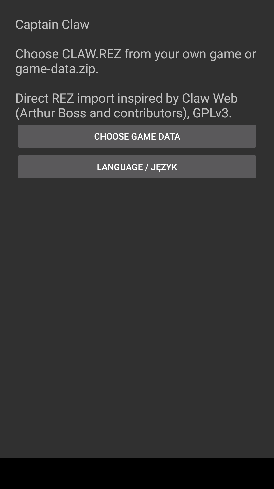
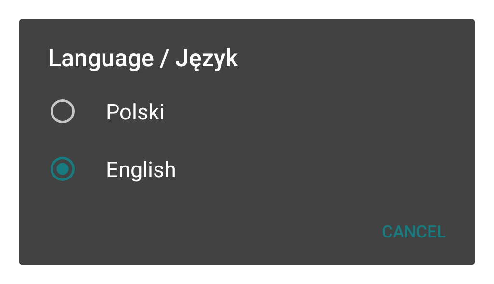

# Install Captain Claw on Android

This is a development version. You need **this port's APK** and **game data from your own PC copy of Claw**. The APK installs the app; the game-data file supplies the levels, graphics and sounds. They are separate files.

You do not need a GitHub account, USB debugging, ADB or Android Studio to install an APK you already have.

## 1. Get the two files ready

**Download the test APK:** open [v0.4.32-test](https://github.com/SlopPort/captain-claw-android/releases/tag/v0.4.32-test), expand **Assets**, and download **`captain-claw-android-0.4.32-test.apk`**. The release also supplies `SHA256SUMS.txt`. This is a development test, not version 1.0. GitHub's source-code archives are not the APK.

- **App installer:** the APK from the test release above, or one you [build from source](BUILDING.en.md). GitHub's **Code → Download ZIP** downloads source code; it cannot be installed on a phone.
- **Game data:** `CLAW.REZ` from your own PC game folder, or a `game-data.zip` prepared with this project's tools. Do not unpack or rename it.

**Which data file should I use?**

| What you have | What to do |
| --- | --- |
| A complete `CLAW.REZ` | Select that file directly in the app. No ZIP preparation is needed. |
| `CLAW.REZ` plus extra loose `Assets` files you want to include | Prepare `game-data.zip` using the steps below. Direct REZ import reads only the archive. |
| A tiny 168-byte `CLAW.REZ` from a CrazyHook installation | This is a placeholder. Prepare a ZIP from the installation's loose `Assets` using the steps below. |
| An existing `game-data.zip` made by this project's packaging tool | Select it directly. A ZIP of the entire PC game folder is not the same package. |

Public sources do not contain Claw game data, and the setup tools do not download it.

## 2. Copy the files to your phone

1. Connect the phone to your computer with a USB cable and unlock it.
2. If the phone asks how to use USB, choose **File transfer**. Labels vary between phones.
3. On the computer, open the phone's storage and its **Download** or **Downloads** folder.
4. Copy the APK and your complete `CLAW.REZ` or prepared `game-data.zip` into that folder.

You can use another file-transfer method if you prefer. The goal is to have both files available on the phone.

## 3. Install the app

1. On the phone, open **Files** (or the phone's file manager), then **Downloads**.
2. Tap the file whose name ends in **`.apk`**.
3. If Android blocks installation, follow its **Settings** link and allow this file manager to **install unknown apps**. Return to the installer and tap **Install**. Older Android versions use different wording. You can turn the permission off afterwards.
4. Tap **Open**, or find **Kapitan Pazur** in the app list.

## 4. Import your game data

1. If you want English interface text, choose **Language / Język → English** on the first screen.
2. Tap **Choose game data**. In Polish this is **Wybierz dane gry**.
3. In Android's file chooser, open **Downloads** and tap `CLAW.REZ` or `game-data.zip`. Select the file itself, not a file inside the ZIP.
4. Wait for the import to finish. The game starts automatically. Leave enough free storage for the app's imported copy as well as the file you selected; ZIP size alone does not show its extracted size.
5. On later launches the app uses its imported files; you do not import them every time.

Language can also be changed under **PAD → Language / Język**. Android screens change immediately; restart the game to apply in-game menu labels. English and Polish interface text are provided by the port. Voices, backgrounds and original score-screen pictures come from your game data. **Choosing English does not translate Polish voices.** See [language and voice limits](GAME-LANGUAGE.md).

### What the first screen looks like

These examples show this port's own screens on Huawei/Android 10, debug 0.4.31, with English selected. Android's installation and file-selection screens vary by phone. They are not screenshots of every supported Android version.





[Image provenance and limits](images/README.md).

## Updates and save backups

The public test APK uses the project's release signing identity. Existing locally built debug installations use a different key and cannot be updated in place with that APK. Keep the current debug app until you have exported and checked a save backup and retained your original game-data file; then follow a deliberate migration plan. Do not uninstall just to dismiss an installation error. Future updates must retain the same signing identity.

To update, install the newer APK over the existing app. Its signing key must match the installed version. If Android reports a signature conflict, keep the existing app and ask for a compatible APK; this does not mean your phone is damaged.

**Uninstalling can delete progress and imported data.** Before uninstalling, open **PAD → Save backups and vibration → Export progress to file** and save the backup somewhere you can find it outside the app's private storage. Keep a separate copy if possible.

Save import accepts this port's XML backups, not Windows saves or Claw Web JSON. After importing, quit through the game's menu and launch again. The previous save is retained in app storage as `SAVES.before-import.xml`; exporting your own external backup is still recommended. Vibration is optional and off by default; controller rumble depends on the controller mode and Android driver.

## Prepare a game-data ZIP, if needed

Skip this section if your complete `CLAW.REZ` imports directly.

### Windows: preparation window

1. Install **Python 3.11 or newer with Tcl/Tk**, and **Git**. Enable Python's **Add to PATH** option during installation.
2. Download and extract this repository's source files on your computer. Open the extracted folder containing `README.md` and `Prepare-game-data.cmd`.
3. Double-click **Prepare-game-data.cmd**. Choose **EN** in its language selector.
4. Select `CLAW.REZ` inside your own PC game installation. For a placeholder REZ, select it in the folder beside its `Assets` directory.
5. Wait. The first preparation needs internet to obtain open-source dependencies; it does not download Claw.
6. The window shows the output path for **`build/game-data.zip`**. Copy that ZIP to the phone and use step 4 above to import it.

The tool leaves the original PC installation unchanged. This preparation window still needs a clean-computer usability test. If it fails to open, use the terminal method below and include its error text in a report.

### Terminal method

1. Install Python 3.11+ and Git, then extract the source files.
2. Open a terminal in the project folder containing `README.md`. On Windows, open the folder in File Explorer, type `powershell` in the address bar and press Enter.
3. Run:

   ```sh
   python tools/bootstrap.py
   python tools/pack_assets.py --game-root "C:\Games\Claw"
   ```

4. Replace `C:\Games\Claw` with your own PC game folder containing `CLAW.REZ`. Keep the quotation marks, especially if the path contains spaces. On Linux/macOS use your installation's path and `python3` if needed.
5. Copy the resulting **`build/game-data.zip`** to the phone and import it.

You do not need to build the APK to prepare this ZIP if you already have an installer.

## If something goes wrong

| Problem | Next step |
| --- | --- |
| Cannot find the data file | Open Downloads in Android's file chooser. Select the archive itself. |
| Invalid or incomplete package | Prepare the ZIP with this project's tool. A ZIP of the entire game folder has the wrong structure. |
| Invalid configuration in the package | Rebuild the ZIP. With a complete original `CLAW.REZ`, you can select it directly and let the app create its configuration. Do not delete saves. |
| Not enough storage | Free space outside the game's storage and retry. Keep any interrupted-import recovery backup; the app needs space to restore it. Do not uninstall as an import repair. |
| App not installed | Record the exact Android message, APK filename and Android version. Check for a signing-key conflict before uninstalling anything. |
| Crash or slow gameplay | Report the APK version, phone model, Android version, level and action just before the problem. |

Android 5/API 21 is the build minimum, not verified compatibility with every device. See the [compatibility matrix](validation/ANDROID-COMPATIBILITY.md).

The port's code is open source. Original Claw data has separate copyright and is excluded from public sources. Possessing a copy does not automatically grant permission to publish its files. See [credits and licenses](../NOTICE.md). Direct REZ import and save workflows are inspired by Claw Web (Arthur Boss and contributors), with an Android implementation and validation in this project.
